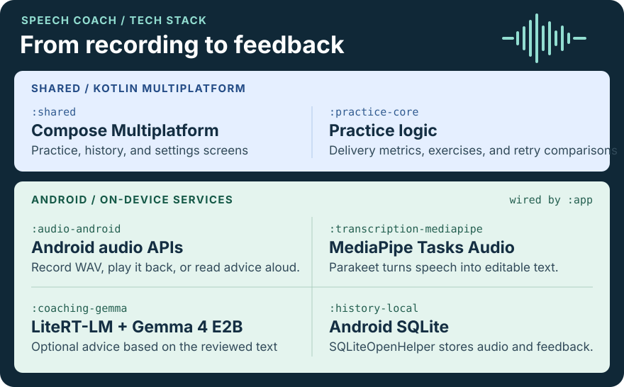

# Speech Coach

Practice a team update, interview answer, or explanation on Android. Record up to two minutes, review your transcript for repeated phrases, then retry the same prompt to compare estimated pace and possible fillers. **Save attempt** keeps the recording and feedback in local history.

## Tech stack



Android is the runnable app. The UI and practice logic also target iOS and desktop; those apps are not yet available.

## Run on Android

With JDK 17+, Android SDK 36, and an Android 9+ device or emulator connected:

```sh
./gradlew :app:installDebug
```

Open **Speech Coach** and grant microphone access. No model is needed if you enter the transcript yourself. For on-device transcription, install **Parakeet** (615 MB) in **Model settings**. For suggestions on the reviewed text, optionally install **Gemma 4 E2B** (2.59 GB; requires a capable 64-bit device).

[Practice guide](docs/practice-guide.md) · [Models and privacy](docs/practice-guide.md#models-and-privacy) · [Tests](docs/practice-guide.md#testing) · [Model credits and licenses](docs/practice-guide.md#model-attribution)
